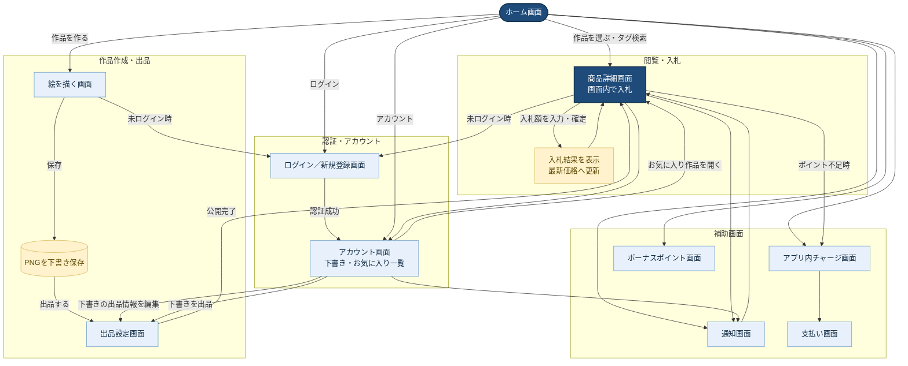
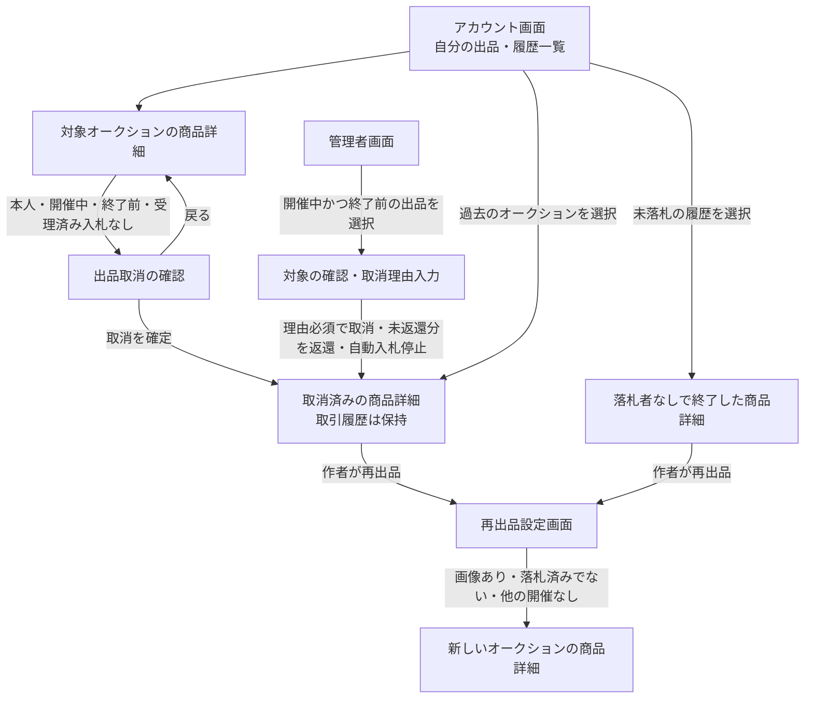
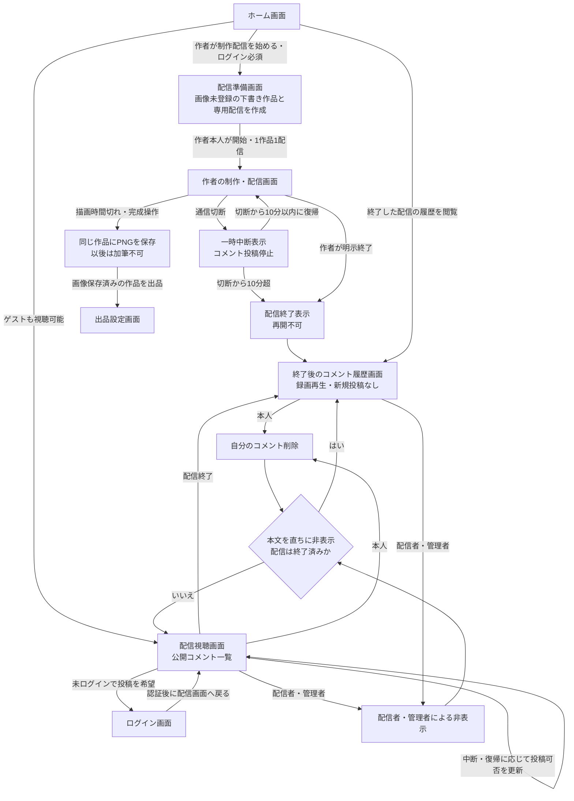

# 画面遷移図

`画面遷移図-memo.md` をもとに、2026/10/20に合意した追加仕様を反映した画面遷移図です。入札は商品詳細画面内で完結し、出品にはPNG保存が必要です。出品取消・再出品・制作配信・コメント・管理者操作は追加仕様であり、Ver0.5の完成条件や実装済み画面とは区別します。DB設計書・SQL・ER図は今回変更していません。

## 出品取消・再出品（追加仕様）

- 入札者向けの入札取消ボタンは設けない。入札後は出品者本人も取消できない。
- 管理者の取消は出品全体を対象とする。次点の入札を復活させず、返還済みポイントを再返還しない。
- 終了日時以降の取消、落札済み作品の再出品は不可。競合などで条件が変わった場合は操作を拒否し、最新状態を表示する。
- 再出品では新しいオークションを作る。旧商品詳細・入札履歴は別の履歴として維持する。

## 制作配信・コメント（追加仕様）

- 配信開始前の下書き登録は画像なしで可能。配信者は作品の作者に限る。作品の下書き管理・編集権限は作者だけに保持する。
- 削除・非表示後は操作元の画面へ戻る。終了済みの場合は視聴画面ではなくコメント履歴画面へ戻る。
- 切断から10分以内だけ同じ配信へ復帰できる。明示終了・自動終了後は再開できず、同じ作品の再配信や再出品による配信枠追加もできない。
- PNG保存と配信終了は別操作。配信終了だけでPNG保存や出品は行わない。保存後の画像への加筆は不可。
- コメントは本人削除・配信者／管理者の非表示のみとし、編集ボタンは設けない。配信前・中断中・終了後の投稿は不可。
- 削除・非表示本文は公開画面から即時に隠し、管理者だけが操作日から1か月閲覧できる。期限後は本文を消去し、操作記録だけを保持する。管理者の監査画面でも期限後の本文は表示しない。
- 通常コメントは終了後もゲストを含め閲覧できる。録画・スーパーチャット・配信から課金への導線は今回の対象外。

## 補足

- 商品詳細画面では、作品・オークションのお気に入りを登録または解除できる。
- ホーム画面では、タグを指定して作品を検索できる。
- 入札結果は商品詳細画面内に再表示し、専用の入札画面には遷移しない。
- 描画画面で保存したPNGは下書きとして保持し、作者だけが出品情報を編集・出品できる。保存後に描画画面へ戻って加筆する導線は設けない。
- 画面番号3の入札画面は廃止済みである。
